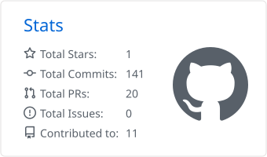
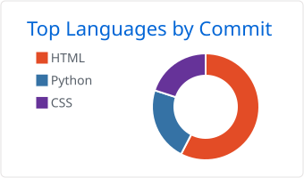
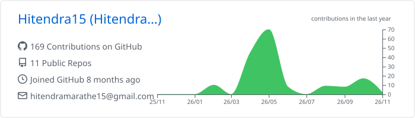
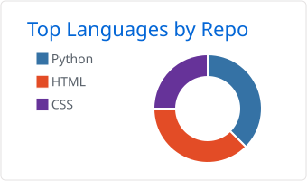

<!-- ============ HEADER ============ -->

  

  

  

    
    
    
  

  

    <a href="#about"><b>About</b></a> &nbsp;·&nbsp;
    <a href="#tech-stack"><b>Tech Stack</b></a> &nbsp;·&nbsp;
    <a href="#experience"><b>Experience</b></a> &nbsp;·&nbsp;
    <a href="#featured-projects"><b>Projects</b></a> &nbsp;·&nbsp;
    <a href="#github-stats"><b>Stats</b></a> &nbsp;·&nbsp;
    <a href="#contact"><b>Contact</b></a>
  

---

## About

<table>
<tr>
<td width="62%" valign="top">

Backend Developer with 3+ years of experience building web applications and backend systems using Python, Django, PHP and Laravel. I enjoy designing database-driven applications, building clean REST APIs, implementing secure authentication and writing maintainable software. Currently working at Chat360 on Django-based enterprise applications.

- 🔭 Building: Vendor Management System
- 🌱 Learning: Django Channels, WebSockets, System Design
- 📍 Based in: Pune, Maharashtra, India
- 💬 Ask me about: Django, DRF, PostgreSQL, Celery, API Design
- 🎓 Education: MCA, K.K. Wagh College

</td>
</tr>
</table>

---

## Tech Stack

| Category | Technologies |
|---|---|
| Backend | Python, Django, DRF, PHP, Laravel, CodeIgniter |
| Databases | PostgreSQL, MySQL |
| Frontend | JavaScript, React, jQuery, HTML, CSS, Bootstrap |
| Async & Real-time | Celery, Django Channels, WebSockets |
| Tools & Cloud | Git, GitHub, Docker, Linux, AWS, Postman |

---

## Experience

<table>
<tr>
<td width="24%" valign="top">
<b>Chat360</b> 
Backend Developer 
*May 2024 – Present*
</td>
<td valign="top">

- Building and maintaining a Django-based **Vendor Management System** for enterprise use
- Developing business modules for **vendor payments, fuel, assets and finance**
- Using **PostgreSQL** and **Celery** for data handling and background processing
- Contributing to backend architecture, application workflows and code quality
<!-- TIP: add measurable impact, e.g. "Reduced report generation time by X% using Celery" -->

</td>
</tr>
<tr>
<td width="24%" valign="top">
<b>Narola Infotech Solution LLP</b> 
Software Engineer 
Feb 2023 – May 2024
</td>
<td valign="top">

- Developed web applications using **PHP, CodeIgniter 3 and Laravel**
- Built business application modules and database-driven functionality
- Contributed to application development, maintenance and bug fixing

</td>
</tr>
</table>

---

## Featured Projects

<table>
<tr>
<td width="50%" valign="top">
  <h3>🗂️ <a href="https://github.com/Hitendra15/trello-clone-api">Trello Clone API</a></h3>
  
Task management app with boards, lists and cards, secured with JWT.

  
  
  
  
  
</td>
<td width="50%" valign="top">
  <h3>🔐 <a href="https://github.com/Hitendra15/django-auth-api">Django Auth API</a></h3>
  
Authentication system with registration, login, JWT and password reset.

  
  
  
</td>
</tr>
<tr>
<td width="50%" valign="top">
  <h3>🎓 <a href="https://github.com/Hitendra15/itdigitech-learning-platform">ITDigiTech Learning Platform</a></h3>
  
Learning management platform with course management and payment integration.

  
  
</td>
<td width="50%" valign="top">
  <h3>🥗 <a href="https://github.com/Hitendra15/macro-tracker">Macro Tracker</a></h3>
  
Macronutrient tracker with meal logging, analytics and live dashboards.

  
  
  
  
</td>
</tr>
<tr>
<td width="50%" valign="top">
  <h3>🛒 <a href="https://github.com/Hitendra15/ecommerce">E-Commerce</a></h3>
  
Full-stack store with cart, checkout and product management.

  
  
</td>
<td width="50%" valign="top">
  <h3>📄 <a href="https://github.com/Hitendra15/cv-generator">CV Generator</a></h3>
  
Resume builder with one-click PDF export.

  
  
</td>
</tr>
</table>

  

---

## GitHub Stats

  <picture>
    <source media="(prefers-color-scheme: dark)" srcset="./profile-summary-card-output/github_dark/3-stats.svg" />
    
  </picture>
  <picture>
    <source media="(prefers-color-scheme: dark)" srcset="./profile-summary-card-output/github_dark/2-most-commit-language.svg" />
    
  </picture>

  <picture>
    <source media="(prefers-color-scheme: dark)" srcset="./profile-summary-card-output/github_dark/0-profile-details.svg" />
    
  </picture>
  <picture>
    <source media="(prefers-color-scheme: dark)" srcset="./profile-summary-card-output/github_dark/1-repos-per-language.svg" />
    
  </picture>

---

## Contact

  
Open to backend roles and interesting Django projects. Let's talk.

  
  

    
  <i>Building, learning and improving one project at a time.</i>

